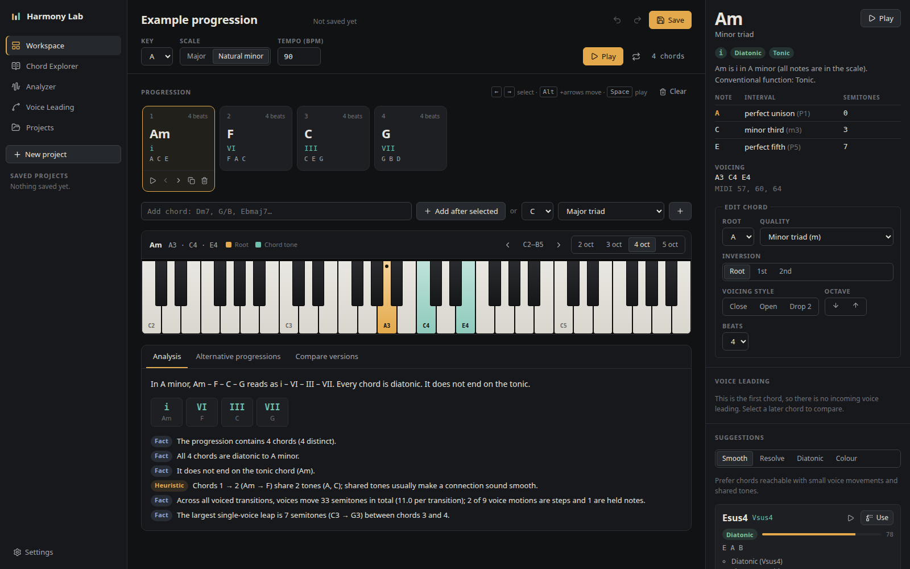
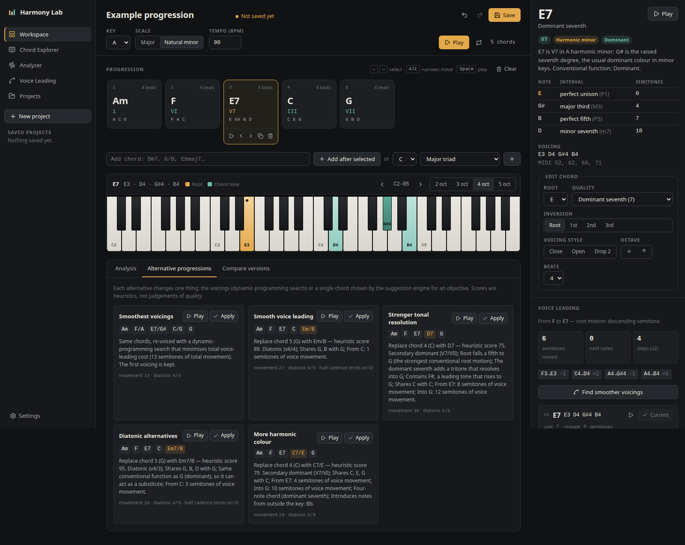
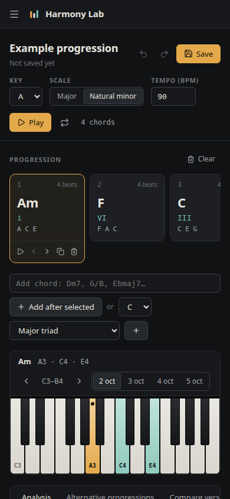

# Harmony Lab

Harmony Lab is an interactive environment for exploring tonal harmony. Build a chord progression, inspect
and hear every chord on a piano keyboard, see a Roman-numeral analysis, compare voicings ranked by a
voice-leading algorithm, and get explained chord suggestions. Projects are saved in PostgreSQL.

All music theory is computed by a **deterministic, unit-tested Java engine**. No AI service or API key is
involved, and every analysis statement is derived from the actual notes.

> Intended for **local, single-user use**. There is no authentication; anyone who can reach the API can
> read and modify all projects.

---

## 1. Main features

| Area | What you can do |
|---|---|
| **Harmony Workspace** | Add chords by symbol (`Dm7`, `G/B`, `F#m7b5`) or from pickers; select, edit root/quality/inversion/voicing style, shift octaves, set beats, reorder (buttons, drag & drop, `Alt+←/→`), duplicate, delete, clear, undo/redo; play a chord or the whole progression with tempo, loop and position indicator; save/rename. |
| **Piano keyboard** | Data-driven highlights of the selected (or currently sounding) voicing, root vs. chord tones, note labels in the chord's own spelling, click-to-audition, 2–5 visible octaves with octave shifting. |
| **Chord Explorer** | Any root × 15 qualities: notes, interval structure, all inversions, relation to a chosen key, the key's diatonic triads and seventh chords, *identify a chord from clicked keys* (with all ambiguous readings), add to progression. |
| **Progression Analyzer** | Roman numerals, diatonic / harmonic-minor / secondary-dominant / borrowed / chromatic classification, conventional functions (with "tentative" flags), root motion, common tones, cadence detection, measured voice-leading metrics, and observations labelled **Fact** or **Heuristic**. |
| **Voice Leading Explorer** | For any adjacent pair: ranked voicings of the next chord with costs, explanations and a motion diagram; audition and apply. A dynamic-programming optimiser re-voices the whole progression. |
| **Suggestions** | Ranked, explained alternatives for the selected chord under four objectives: smooth voice leading, stronger resolution, diatonic alternatives, more harmonic colour. Audition or replace with one click. Says so when nothing scores well. |
| **Alternatives & comparison** | Whole-progression alternatives (re-voiced, or best single change per objective) and a metrics table comparing the current version, the last saved version and an alternative. |
| **Saved Projects** | Create, list, open, update, rename, duplicate, delete. Optimistic locking prevents silently overwriting changes made in another tab; unsaved changes are indicated and confirmed before being discarded. |

## 2. Screenshots

Screenshots of the running application are in [`docs/screenshots`](docs/screenshots):

| Workspace | Alternatives and inspector |
|---|---|
|  |  |
| **Chord Explorer** | **Voice Leading Explorer** |
|  |  |
| **Analyzer** | **Mobile** |
|  |  |

**Adding or updating screenshots:** start the app (see below), take a screenshot of the page at a
1600×1000 window (or 390×844 for mobile), save it as a PNG in `docs/screenshots/` and reference it in the
table above with a relative path.

## 3. Architecture overview

```
 Browser (React + TypeScript, Vite)                       Spring Boot (Java 21) — modular monolith
 ┌───────────────────────────────────────┐   /api/*   ┌───────────────────────────────────────────┐
 │ pages/        Workspace, Explorer,    │  JSON over │ api/        error handling, DTOs, mapping │
 │               Analyzer, VoiceLeading, │ ─────────▶ │ theory/     stateless theory endpoints    │
 │               Projects                │   REST     │ project/    persistence use cases (JPA)   │
 │ state/        reducer + providers     │            │ music/      ◀── pure domain, no framework │
 │ audio/        Tone.js engine (lazy)   │            │   analysis/ voiceleading/ suggestion/     │
 │ components/   keyboard, inspector...  │            └──────────────────────┬────────────────────┘
 └───────────────────────────────────────┘                                   │ Flyway + JPA
                                                                   ┌─────────▼─────────┐
                                                                   │ PostgreSQL 17     │
                                                                   └───────────────────┘
```

* **`backend/src/main/java/com/harmonylab/music`** is the musical domain: `NoteName`, `Note`, `PitchClass`,
  `Interval`, `ChordQuality`, `Chord`, `ChordSymbol`, `ChordIdentifier`, `Key`, `Mode`, `RomanNumeral`,
  `Voicing`, `VoicingGenerator`, plus the `analysis`, `voiceleading` and `suggestion` engines. It has no
  dependency on Spring, HTTP, JPA or audio, and is covered by plain JUnit tests.
* **`theory`** exposes the engine statelessly (resolve/parse/identify chords, keys, analysis, voice
  leading, optimisation, suggestions, alternatives). **`project`** persists workspaces. **`api`** holds
  the shared DTOs, the DTO↔domain mapper (with precise field paths such as `chords[2].voicing`) and the
  RFC 9457 problem-details error handler.
* The **frontend** keeps the workspace in a pure reducer (`src/model/workspace.ts`) with explicit order,
  undo/redo history and dirty tracking, and asks the backend for every musical computation.

Repository layout:

```
harmony-lab/
├── backend/                 Spring Boot app (Maven wrapper, Dockerfile)
│   ├── src/main/java/com/harmonylab/{music,theory,project,api}
│   ├── src/main/resources/{application.yml, db/migration/V1__create_projects.sql}
│   └── src/test/java/...    unit tests (*Test) and Testcontainers integration tests (*IT)
├── frontend/                React + Vite app (Dockerfile, nginx.conf)
│   └── src/{api,audio,components,model,pages,state,styles,test}
├── docs/                    music-engine.md, screenshots/
├── docker-compose.yml
├── .env.example
└── .github/workflows/ci.yml
```

## 4. Technology stack

| Layer | Choice |
|---|---|
| Frontend | React 19, TypeScript 6 (strict), Vite 8, React Router 8, Tone.js 15, lucide-react, CSS Modules |
| Frontend tests | Vitest 5, React Testing Library, user-event, jsdom; oxlint |
| Backend | Java 21, Spring Boot 4.1 (Web MVC, Validation, Data JPA / Hibernate 7), Flyway, PostgreSQL 17, springdoc-openapi 3.1 |
| Backend tests | JUnit 6 (Jupiter), AssertJ, Mockito, Spring MockMvc, Testcontainers 2 |
| Infrastructure | Docker multi-stage builds, Docker Compose, nginx (static files + `/api` reverse proxy), GitHub Actions |

## 5. Prerequisites

* **Docker** with Docker Compose v2 (to run everything, and for the backend integration tests)
* For local development without Docker images: **JDK 21** and **Node.js 22** (npm 10). Maven is not
  required; the repository ships the Maven wrapper (`./mvnw`).

## 6. Local development setup

```bash
cp .env.example .env                 # local-only defaults; matches the backend's defaults
docker compose up -d postgres        # PostgreSQL on localhost:5432

# terminal 1 — API on http://localhost:8081 (Flyway migrates the schema on start-up)
cd backend
./mvnw spring-boot:run

# terminal 2 — UI on http://localhost:5173 (Vite proxies /api to localhost:8081)
cd frontend
npm install
npm run dev
```

If port 8081 is taken, start the backend with `SERVER_PORT=8082 ./mvnw spring-boot:run` and the frontend
with `VITE_API_PROXY_TARGET=http://localhost:8082 npm run dev`.

## 7. Docker Compose setup

```bash
cp .env.example .env
docker compose up --build            # postgres + backend + frontend
# open http://localhost:3000
docker compose down                  # stop (add -v to also delete the database volume)
```

The frontend container serves the built app with nginx and proxies `/api` to the backend container, so the
browser only talks to one origin.

## 8. Environment variables

| Variable | Used by | Default | Purpose |
|---|---|---|---|
| `POSTGRES_DB` / `POSTGRES_USER` / `POSTGRES_PASSWORD` | compose | `harmonylab` / `harmonylab` / *(required)* | Database name and credentials |
| `POSTGRES_PORT`, `BACKEND_PORT`, `FRONTEND_PORT` | compose | `5432`, `8081`, `3000` | Host ports |
| `DB_URL` | backend | `jdbc:postgresql://localhost:5432/harmonylab` | JDBC URL |
| `DB_USERNAME`, `DB_PASSWORD` | backend | `harmonylab`, `harmonylab` | DB credentials (**local defaults only**; set real values elsewhere) |
| `SERVER_PORT` | backend | `8081` | HTTP port |
| `APP_CORS_ALLOWED_ORIGINS` | backend | `http://localhost:5173` | Origins allowed to call the API directly |
| `VITE_API_PROXY_TARGET` | frontend dev server | `http://localhost:8081` | Where Vite proxies `/api` |
| `VITE_API_BASE_URL` | frontend build | *(empty: same origin)* | Absolute API URL if the API is on another origin |

`.env` is git-ignored; only `.env.example` (with clearly local-only values) is committed.

## 9. Running backend tests

```bash
cd backend
./mvnw test      # unit + web-slice tests: domain engine, services (Mockito), controllers (MockMvc); no Docker needed
./mvnw verify    # additionally runs *IT integration tests against a real PostgreSQL started by Testcontainers (needs Docker)
```

Integration tests cover project creation/retrieval/update/rename/duplicate/deletion, validation errors,
persistence of the ordered progression (including reordering and shrinking), optimistic-lock conflicts,
atomicity of rejected updates, database constraints, the health endpoint and the OpenAPI document.

## 10. Running frontend tests

```bash
cd frontend
npm test             # Vitest + React Testing Library
npm run lint         # oxlint
npm run typecheck    # tsc (strict)
npm run build        # production build
```

Tests cover the workspace reducer (ordering, selection consistency, undo/redo, dirty tracking, save
races), the HTTP error mapping, the keyboard component, and user flows rendered as a whole app with the API
and audio engine mocked at the module boundary: selecting and editing chords, keyboard highlights, reordering
by button and shortcut, duplicate/delete/undo, chord-symbol and tempo validation, playback calls, save
success/failure, project list errors with retry, rename validation and confirmed deletion.

## 11. Accessing the application

* Docker Compose: <http://localhost:3000>
* Local development: <http://localhost:5173>

Keyboard shortcuts in the workspace: `←/→` select, `Alt+←/→` move, `Space` play/stop, `Enter` play chord,
`Delete` remove, `Ctrl+D` duplicate, `Ctrl+Z` / `Ctrl+Shift+Z` undo/redo, `Ctrl+S` save.

## 12. API documentation

* Swagger UI: <http://localhost:8081/swagger-ui.html>
* OpenAPI JSON: <http://localhost:8081/v3/api-docs>
* Health: `GET /api/health` → `{"status":"UP","database":"UP"}` (503 when the database is unreachable)

Main endpoints:

| Method | Path | Purpose |
|---|---|---|
| `GET` | `/api/projects` | List projects (summaries) |
| `POST` | `/api/projects` | Create (201 + `Location`) |
| `GET` / `PUT` / `PATCH` / `DELETE` | `/api/projects/{id}` | Retrieve / replace (needs `version`) / rename (needs `version`) / delete |
| `POST` | `/api/projects/{id}/duplicate` | Duplicate |
| `GET` | `/api/theory/catalog` | Qualities, roots, keys, objectives |
| `POST` | `/api/theory/chords/resolve` · `/parse` · `/identify` | Build, parse or identify chords |
| `GET` | `/api/theory/keys?tonic=Eb&mode=MAJOR` | Scale, signature, diatonic chords |
| `POST` | `/api/theory/analyze` | Progression analysis |
| `POST` | `/api/theory/voice-leading` · `/voice-leading/optimize` | Ranked voicings / whole-progression optimisation |
| `POST` | `/api/theory/suggestions` · `/alternatives` | Suggestions / whole-progression alternatives |

Errors are `application/problem+json`: `{"title","status","detail","errors":[{"field","message"}]}`. Stack
traces are never returned; unexpected errors are logged server-side.

## 13. Design decisions

* **One source of musical truth.** The Java domain is the only place where chords, keys, spelling and
  analysis are computed. The UI calls it instead of duplicating theory in TypeScript, which keeps results
  consistent and makes the logic testable in one place. The cost is a network round trip per edit
  (a few milliseconds locally), hidden behind optimistic, per-chord "updating" states with stale-response
  protection.
* **Structured chords, not strings.** A chord is `(NoteName root, ChordQuality quality, int inversion)`.
  Symbols are produced and parsed only by `ChordSymbol`. Notes are spelled letter by letter, so
  Db minor is Db–Fb–Ab and E7 contains G#, not Ab.
* **Pitch convention.** MIDI numbers for absolute pitch, pitch classes 0–11 for octave-free comparison,
  scientific pitch notation for names: **middle C = C4 = MIDI 60**. The octave number belongs to the
  letter, so B#3 = C4 = 60.
* **Voice leading = dynamic programming twice.** Voices are matched order-preservingly (a DP handles
  chords with different numbers of notes), and whole progressions are re-voiced with a Viterbi-style DP
  over candidate voicings. See [`docs/music-engine.md`](docs/music-engine.md).
* **Explainable heuristics.** Suggestion scores are weighted sums of measured features, the breakdown
  is returned with each suggestion, and the UI labels scores as heuristic ranking aids. Analysis
  observations are typed `FACT` or `HEURISTIC`.
* **Persistence.** The progression is a JPA `@ElementCollection` with an `@OrderColumn`, so the position is
  an explicit column in the primary key `(project_id, position)`. Voicings are stored as a validated
  comma-separated string (always read and written as a whole). `@Version` plus an explicit version check
  turns lost updates into a 409. All input is validated against the domain *before* anything is written,
  inside one transaction. The schema is owned by Flyway; Hibernate only validates it.
* **Audio.** A single lazily created Tone.js engine (module singleton) started on the first user gesture,
  a soft FM "electric piano" voice, and Transport scheduling in ticks so chords are simultaneous and tempo
  changes apply live.
* **Deliberately not included:** authentication, microservices, caching layers or message brokers. None
  is needed for a single-user local tool.

## 14. Known limitations

* **Single user.** No accounts or authorisation; do not expose the API publicly.
* **Theory scope.** Major and natural-minor keys (harmonic minor is recognised for V/vii° in minor).
  15 chord qualities, without 9ths/11ths/13ths beyond add9, altered dominants or slash chords whose
  bass is not a chord tone. Chord identification only reports exact pitch-class matches (no omitted 5ths).
  No automatic key detection.
* **Analysis.** Function labels follow textbook conventions and are marked tentative where context
  decides (iii, VI, VII in minor). Secondary dominants are recognised for V/V7 types only (not vii°/x).
* **Voicings.** Each chord tone appears exactly once (no doublings), at most two octaves wide. The
  voice-leading weights are hand-tuned, not learned or perceptually validated.
* **Sound.** A synthesised FM voice, not a sampled piano. Timing depends on the browser's audio clock;
  very dense loops on slow machines may glitch. The note duration is fixed at about 96% of each
  chord's length (no sustain pedal or dynamics).
* **Conflict handling** is "detect and let the user choose" (reload or save a copy), not merging.

## 15. Future improvements

* Harmonic/melodic minor and modal keys; extended and altered chords; doubled voicings for four-part writing.
* Automatic key detection (e.g. Krumhansl–Schmuckler profiles) as an *optional* hint.
* MIDI export/import and Web MIDI input from a real keyboard.
* Sampled piano option, per-chord rhythm patterns and arpeggiation.
* Version history per project (snapshots) with diff and restore.
* Optional authentication and per-user projects if multi-user hosting is ever needed.
* End-to-end browser tests (Playwright) in CI.

## 16. Verification status

The following were run successfully while preparing this repository:

* `./mvnw verify` (unit, web-slice and Testcontainers PostgreSQL integration tests) — passing.
* `npm run lint`, `npm run typecheck`, `npm test`, `npm run build` — passing (lint reports only warnings).
* `docker compose up --build` — all three services start; Flyway migrates; `/api/health` is UP through nginx.
* A scripted headless-Chromium walkthrough against the Compose stack: load the example, select and edit
  chords (keyboard highlights checked), undo, add a chord by symbol, play and stop (Tone.js started without
  errors), find voicings, load alternatives, save, open each page, delete via the UI, check the mobile layout
  for horizontal overflow. No console errors.
* The GitHub Actions workflow has **not** been run on GitHub yet (it mirrors the commands above).
