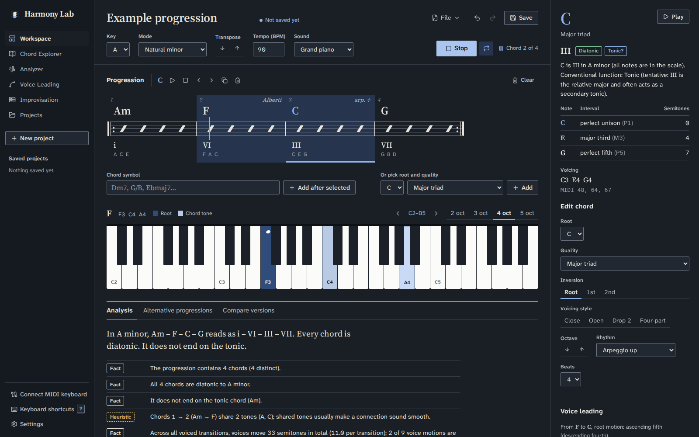

# Harmony Lab

[](https://github.com/matisdpz/harmony-lab/actions/workflows/ci.yml)

Harmony Lab is an interactive environment for exploring tonal harmony. Build a chord progression, inspect
and hear every chord on a piano keyboard, see a Roman-numeral analysis, compare voicings ranked by a
voice-leading algorithm, and get explained chord suggestions. Projects are saved in PostgreSQL.

All music theory is computed by a **deterministic, unit-tested Java engine**. No AI service or API key is
involved, and every analysis statement is derived from the actual notes.

> Intended for **local, single-user use**. There is no authentication; anyone who can reach the API can
> read and modify all projects.

---

## 1. Main features

| Area | What you can do |
|---|---|
| **Harmony Workspace** | Add chords by symbol (`Dm7`, `G/B`, `F#m7b5`, `G13`, `C7alt`) or from pickers; select, edit root/quality/inversion/voicing style, shift octaves, set beats and a **rhythm** per chord (block, arpeggios, Alberti bass, repeated, bass and chord); reorder (buttons, drag & drop, `Alt+←/→`), duplicate, delete, clear, undo/redo; **transpose** everything by a semitone with correct spelling; play the progression or **from the selected chord**, with tempo, loop and a playhead; choose the **sound** (grand piano samples, electric piano, organ, pad, plucked strings, vibraphone); save/rename. A quiet hint appears when the chords clearly sound like another key. |
| **MIDI** | Connect a **MIDI keyboard** (Web MIDI): notes sound with the chosen instrument, the sustain pedal works, the on-screen keyboards show what you play, a held chord is named and can be added in one click, and the Explorer's identification mode reads it. **Export** the progression as a `.mid` file (with each chord's rhythm) and **import** a `.mid` file as chords. |
| **Piano keyboard** | Data-driven highlights of the selected (or currently sounding) voicing, root vs. chord tones, note labels in the chord's own spelling, click-to-audition, 2–5 visible octaves with octave shifting. |
| **Chord Explorer** | Any root × 28 qualities (triads, sevenths, sixths, suspended, added, **9/11/13** and **altered dominants**): notes, interval structure, all inversions, relation to a chosen key, the key's diatonic triads and seventh chords, *identify a chord from clicked keys* (with all ambiguous readings), add to progression. |
| **Progression Analyzer** | A **key estimate** (Krumhansl–Schmuckler, with the three likeliest keys and their correlation), Roman numerals, diatonic / harmonic-minor / secondary-dominant / borrowed / chromatic classification, conventional functions (with "tentative" flags), root motion, common tones, cadence detection, measured voice-leading metrics, and observations labelled **Fact** or **Heuristic**. |
| **Voice Leading Explorer** | For any adjacent pair: ranked voicings of the next chord with costs, explanations and a motion diagram; audition and apply. A dynamic-programming optimiser re-voices the whole progression. Optional **four-voice writing** doubles the root of triads. |
| **Suggestions** | Ranked, explained alternatives for the selected chord under four objectives: smooth voice leading, stronger resolution, diatonic alternatives, more harmonic colour. Audition or replace with one click. Says so when nothing scores well. |
| **Alternatives & comparison** | Whole-progression alternatives (re-voiced, or best single change per objective) and a metrics table comparing the current version, the last saved version and an alternative. |
| **Keys and modes** | Major, natural / harmonic / melodic minor, and the Dorian, Phrygian, Lydian, Mixolydian and Locrian modes, everywhere a key is chosen. |
| **Improvisation** | Loop a preset progression (pop, 50s, jazz ii–V–I, canon, 12-bar blues, minor pop, Andalusian, minor ii–V–i, minor blues, and one vamp per mode — realised in any key), with an optional **one-bar count-in** and **metronome**,, your workspace progression or one you type (`Dm7 G7 Cmaj7`, kept in this browser). For the chord that is sounding, the keyboard marks the root, the chord tones, the safe scale notes (a small dot) and the **tension notes in red** (avoid notes, ♭9/♯9/♭13 on dominants, blue notes), with a reason for each. The next chord is shown beside the current one. Play along with the mouse or the computer keyboard (`A W S E D F T G Y H U J K`, `Z`/`X` octave). |
| **Saved Projects** | Create, list, open, update, rename, duplicate, delete. Optimistic locking prevents silently overwriting changes made in another tab; unsaved changes are indicated and confirmed before being discarded. |

## 2. Screenshots

Screenshots of the running application are in [`docs/screenshots`](docs/screenshots):

| Workspace (day) | Workspace (night, looping playback) |
|---|---|
|  |  |
| **Alternative progressions** | **Improvisation** |
|  |  |
| **Chord Explorer** | **Voice Leading Explorer** |
|  |  |
| **Analyzer** | **Mobile** |
|  |  |

**Adding or updating screenshots:** start the app (see below), take a screenshot of the page at a
1600×1000 window (or 390×844 for mobile), save it as a PNG in `docs/screenshots/` and reference it in the
table above with a relative path. Pin the theme in Settings (Day or Night) so the screenshot does not depend
on the operating system's colour scheme.

## 3. Architecture overview

```
 Browser (React + TypeScript, Vite)                       Spring Boot (Java 21) — modular monolith
 ┌───────────────────────────────────────┐   /api/*   ┌───────────────────────────────────────────┐
 │ pages/        Workspace, Explorer,    │  JSON over │ api/        error handling, DTOs, mapping │
 │               Analyzer, VoiceLeading, │ ─────────▶ │ theory/     stateless theory endpoints    │
 │               Improvisation, Projects │   REST     │ project/    persistence use cases (JPA)   │
 │ state/        reducer + providers     │            │ music/      ◀── pure domain, no framework │
 │ audio/        Tone.js engine (lazy)   │            │   analysis/ voiceleading/ suggestion/     │
 │ components/   keyboard, inspector...  │            │   improvisation/                          │
 └───────────────────────────────────────┘            └──────────────────────┬────────────────────┘
                                                                             │ Flyway + JPA
                                                                   ┌─────────▼─────────┐
                                                                   │ PostgreSQL 17     │
                                                                   └───────────────────┘
```

* **`backend/src/main/java/com/harmonylab/music`** is the musical domain: `NoteName`, `Note`, `PitchClass`,
  `Interval`, `ChordQuality`, `Chord`, `ChordSymbol`, `ChordIdentifier`, `Key`, `Mode`, `RomanNumeral`,
  `Voicing`, `VoicingGenerator`, plus the `analysis`, `voiceleading` and `suggestion` engines. It has no
  dependency on Spring, HTTP, JPA or audio, and is covered by plain JUnit tests.
* **`theory`** exposes the engine statelessly (resolve/parse/identify chords, keys, analysis, voice
  leading, optimisation, suggestions, alternatives). **`project`** persists workspaces. **`api`** holds
  the shared DTOs, the DTO↔domain mapper (with precise field paths such as `chords[2].voicing`) and the
  RFC 9457 problem-details error handler.
* The **frontend** keeps the workspace in a pure reducer (`src/model/workspace.ts`) with explicit order,
  undo/redo history and dirty tracking, and asks the backend for every musical computation.

Repository layout:

```
harmony-lab/
├── backend/                 Spring Boot app (Maven wrapper, Dockerfile)
│   ├── src/main/java/com/harmonylab/{music,theory,project,api}
│   ├── src/main/resources/{application.yml, db/migration/V1__create_projects.sql}
│   └── src/test/java/...    unit tests (*Test) and Testcontainers integration tests (*IT)
├── frontend/                React + Vite app (Dockerfile, nginx.conf)
│   └── src/{api,audio,components,model,pages,state,styles,test}
├── docs/                    music-engine.md, screenshots/
├── docker-compose.yml
├── .env.example
└── .github/workflows/ci.yml
```

## 4. Technology stack

| Layer | Choice |
|---|---|
| Frontend | React 19, TypeScript 6 (strict), Vite 8, React Router 8, Tone.js 15, @tonejs/midi, lucide-react, CSS Modules; Web MIDI API; Salamander Grand Piano samples (CC-BY 3.0, `frontend/public/samples/piano`); self-hosted fonts via Fontsource (Source Serif 4, Atkinson Hyperlegible Next, Noto Music) |
| Frontend tests | Vitest 5, React Testing Library, user-event, jsdom; oxlint |
| Backend | Java 21, Spring Boot 4.1 (Web MVC, Validation, Data JPA / Hibernate 7), Flyway, PostgreSQL 17, springdoc-openapi 3.1 |
| Backend tests | JUnit 6 (Jupiter), AssertJ, Mockito, Spring MockMvc, Testcontainers 2 |
| Infrastructure | Docker multi-stage builds, Docker Compose, nginx (static files + `/api` reverse proxy), GitHub Actions |

## 5. Prerequisites

* **Docker** with Docker Compose v2 (to run everything, and for the backend integration tests)
* For local development without Docker images: **JDK 21** and **Node.js 22** (npm 10). Maven is not
  required; the repository ships the Maven wrapper (`./mvnw`).

## 6. Local development setup

```bash
cp .env.example .env                 # local-only defaults; matches the backend's defaults
docker compose up -d postgres        # PostgreSQL on localhost:5432

# terminal 1 — API on http://localhost:8081 (Flyway migrates the schema on start-up)
cd backend
./mvnw spring-boot:run

# terminal 2 — UI on http://localhost:5173 (Vite proxies /api to localhost:8081)
cd frontend
npm install
npm run dev
```

If port 8081 is taken, start the backend with `SERVER_PORT=8082 ./mvnw spring-boot:run` and the frontend
with `VITE_API_PROXY_TARGET=http://localhost:8082 npm run dev`.

## 7. Docker Compose setup

```bash
cp .env.example .env
docker compose up --build            # postgres + backend + frontend
# open http://localhost:3000
docker compose down                  # stop (add -v to also delete the database volume)
```

The frontend container serves the built app with nginx and proxies `/api` to the backend container, so the
browser only talks to one origin.

## 8. Environment variables

| Variable | Used by | Default | Purpose |
|---|---|---|---|
| `POSTGRES_DB` / `POSTGRES_USER` / `POSTGRES_PASSWORD` | compose | `harmonylab` / `harmonylab` / *(required)* | Database name and credentials |
| `POSTGRES_PORT`, `BACKEND_PORT`, `FRONTEND_PORT` | compose | `5432`, `8081`, `3000` | Host ports |
| `DB_URL` | backend | `jdbc:postgresql://localhost:5432/harmonylab` | JDBC URL |
| `DB_USERNAME`, `DB_PASSWORD` | backend | `harmonylab`, `harmonylab` | DB credentials (**local defaults only**; set real values elsewhere) |
| `SERVER_PORT` | backend | `8081` | HTTP port |
| `APP_CORS_ALLOWED_ORIGINS` | backend | `http://localhost:5173` | Origins allowed to call the API directly |
| `VITE_API_PROXY_TARGET` | frontend dev server | `http://localhost:8081` | Where Vite proxies `/api` |
| `VITE_API_BASE_URL` | frontend build | *(empty: same origin)* | Absolute API URL if the API is on another origin |

`.env` is git-ignored; only `.env.example` (with clearly local-only values) is committed.

## 9. Running backend tests

```bash
cd backend
./mvnw test      # unit + web-slice tests: domain engine, services (Mockito), controllers (MockMvc); no Docker needed
./mvnw verify    # additionally runs *IT integration tests against a real PostgreSQL started by Testcontainers (needs Docker)
```

Integration tests cover project creation/retrieval/update/rename/duplicate/deletion, validation errors,
persistence of the ordered progression (including reordering and shrinking), optimistic-lock conflicts,
atomicity of rejected updates, database constraints, the health endpoint and the OpenAPI document.

## 10. Running frontend tests

```bash
cd frontend
npm test             # Vitest + React Testing Library
npm run lint         # oxlint
npm run typecheck    # tsc (strict)
npm run build        # production build
```

Tests cover the workspace reducer (ordering, selection consistency, undo/redo, dirty tracking, save
races), the HTTP error mapping, the keyboard component, and user flows rendered as a whole app with the API
and audio engine mocked at the module boundary: selecting and editing chords, keyboard highlights, reordering
by button and shortcut, duplicate/delete/undo, chord-symbol and tempo validation, playback calls, save
success/failure, project list errors with retry, rename validation and confirmed deletion, and the improvisation
page (guide colours on the keyboard, looped playback, computer-keyboard notes, custom progression validation),
the display of real accidentals (`F#m7b5` → F♯m7♭5 in symbols, numerals and prose, without touching words
such as "Absent"), and theme selection.

## 11. Accessing the application

* Docker Compose: <http://localhost:3000>
* Local development: <http://localhost:5173>

Keyboard shortcuts in the workspace: `←/→` select, `Alt+←/→` move, `Space` play/stop, `Enter` play chord,
`Delete` remove, `Ctrl+D` duplicate, `Ctrl+Z` / `Ctrl+Shift+Z` undo/redo, `Ctrl+S` save.

## 12. API documentation

* Swagger UI: <http://localhost:8081/swagger-ui.html>
* OpenAPI JSON: <http://localhost:8081/v3/api-docs>
* Health: `GET /api/health` → `{"status":"UP","database":"UP"}` (503 when the database is unreachable)

Main endpoints:

| Method | Path | Purpose |
|---|---|---|
| `GET` | `/api/projects` | List projects (summaries) |
| `POST` | `/api/projects` | Create (201 + `Location`) |
| `GET` / `PUT` / `PATCH` / `DELETE` | `/api/projects/{id}` | Retrieve / replace (needs `version`) / rename (needs `version`) / delete |
| `POST` | `/api/projects/{id}/duplicate` | Duplicate |
| `GET` | `/api/theory/catalog` | Qualities, roots, keys, objectives |
| `POST` | `/api/theory/chords/resolve` · `/parse` · `/identify` | Build, parse or identify chords |
| `GET` | `/api/theory/keys?tonic=Eb&mode=MAJOR` | Scale, signature, diatonic chords (any of the 9 modes) |
| `POST` | `/api/theory/keys/detect` | Most likely major/minor keys of a progression, with correlations and confidence |
| `POST` | `/api/theory/transpose` | Key and chords moved by −11…11 semitones, spelled with the fewest accidentals |
| `POST` | `/api/theory/analyze` | Progression analysis |
| `POST` | `/api/theory/voice-leading` · `/voice-leading/optimize` | Ranked voicings / whole-progression optimisation (`fourVoices` doubles the root of triads) |
| `POST` | `/api/theory/suggestions` · `/alternatives` | Suggestions / whole-progression alternatives |
| `GET` | `/api/theory/presets?tonic=A&mode=MINOR` | Preset progressions realised and voiced in a key |
| `POST` | `/api/theory/improvisation` | Per chord: voicing plus chord tones, safe notes and tension notes (from `chords` or `symbols`) |

Errors are `application/problem+json`: `{"title","status","detail","errors":[{"field","message"}]}`. Stack
traces are never returned; unexpected errors are logged server-side.

## 13. Design decisions

* **One source of musical truth.** The Java domain is the only place where chords, keys, spelling and
  analysis are computed. The UI calls it instead of duplicating theory in TypeScript, which keeps results
  consistent and makes the logic testable in one place. The cost is a network round trip per edit
  (a few milliseconds locally), hidden behind optimistic, per-chord "updating" states with stale-response
  protection.
* **Structured chords, not strings.** A chord is `(NoteName root, ChordQuality quality, int inversion)`.
  Symbols are produced and parsed only by `ChordSymbol`. Notes are spelled letter by letter, so
  Db minor is Db–Fb–Ab and E7 contains G#, not Ab.
* **Pitch convention.** MIDI numbers for absolute pitch, pitch classes 0–11 for octave-free comparison,
  scientific pitch notation for names: **middle C = C4 = MIDI 60**. The octave number belongs to the
  letter, so B#3 = C4 = 60.
* **Voice leading = dynamic programming twice.** Voices are matched order-preservingly (a DP handles
  chords with different numbers of notes), and whole progressions are re-voiced with a Viterbi-style DP
  over candidate voicings. See [`docs/music-engine.md`](docs/music-engine.md).
* **Explainable heuristics.** Suggestion scores are weighted sums of measured features, the breakdown
  is returned with each suggestion, and the UI labels scores as heuristic ranking aids. Analysis
  observations are typed `FACT` or `HEURISTIC`.
* **Persistence.** The progression is a JPA `@ElementCollection` with an `@OrderColumn`, so the position is
  an explicit column in the primary key `(project_id, position)`. Voicings are stored as a validated
  comma-separated string (always read and written as a whole). `@Version` plus an explicit version check
  turns lost updates into a 409. All input is validated against the domain *before* anything is written,
  inside one transaction. The schema is owned by Flyway; Hibernate only validates it.
* **Audio.** A single lazily created Tone.js engine (module singleton) started on the first user gesture,
  a soft FM "electric piano" voice, and Transport scheduling in ticks so chords are simultaneous and tempo
  changes apply live.
* **Visual design ("Urtext").** The interface borrows the conventions of an engraved score instead of a
  dashboard: the progression is one line of a lead sheet (one measure per chord, width proportional to its
  beats, beat slashes, barlines, repeat signs when looping, a playhead that crosses the sounding measure),
  Roman numerals sit under the chords as in a harmony textbook, and regions are separated by rules rather
  than boxed cards. Colour has one meaning each: blue for the chord root, the selection and the main action;
  pale blue for other chord tones; red for tensions and errors; amber italics for chords outside the key.
  Chord symbols and numerals use Source Serif 4, the interface uses Atkinson Hyperlegible Next, and real
  accidentals (♭ ♯) are displayed through a small `@font-face` built from Noto Music (`formatMusic` in
  `src/model/notes.ts`; the API and inputs keep ASCII `b`/`#`). Text contrast meets WCAG AA, and every
  keyboard role also has a shape (notehead mark, dot, red bar) so colour is never the only cue.
  Tokens and rationale are at the top of `frontend/src/styles/global.css`.
* **Day and night themes.** Every colour token is written once as `light-dark(day, night)`, so the browser
  picks the value from the page's `color-scheme`. Settings → Theme offers *Match system* (default), *Day*
  and *Night*; a pinned choice sets `data-theme` on `<html>`, and a small inline script in `index.html`
  applies it before the first paint so there is no flash. The piano keyboard deliberately stays ivory and
  ebony in both themes, with the same role colours, because it represents a physical instrument.
* **Extended chords and modes in the same model.** Extended and altered qualities are just more interval
  lists (with compound intervals such as the ♭9 and ♯11), so spelling, inversions, identification and Roman
  numerals work unchanged. Code that needs "a dominant" asks `ChordQuality.isDominantType()` (7, 9, 11, 13 and
  altered) instead of testing for one quality. Modes are scales: `Mode.isTonal()` decides whether
  tonic/predominant/dominant labels apply (major and the minors) or only the tonic is labelled (church modes),
  and `Mode.signatureMode()` gives harmonic and melodic minor the natural minor's key signature.
* **Key detection is a hint.** Krumhansl–Schmuckler correlates the duration-weighted pitch-class profile with the
  Krumhansl–Kessler major and minor profiles. Relative keys share every note, so when the two best candidates
  are relatives and close, the confidence is reported as weak and the hint is not shown; the key is never
  changed without a click.
* **Transposition** moves every root by the same *spelled* interval as the tonic (A minor → B♭ minor turns F into
  G♭, not F♯), and each voicing by the smaller of the two directions so repeated transposition does not drift.
* **Rhythm and sound are presentation.** Playback patterns are pure functions (`model/rhythm.ts`) shared by audio
  playback and MIDI export; the pattern is stored with each saved chord, but the theory engine ignores it.
  Instruments sit behind one small `Voice` interface; only the grand piano uses samples (2 MB, served
  locally so the app works offline).
* **MIDI import** cuts the file into beats, keeps notes that sound for at least half a beat (falling back to
  every note in the surrounding two beats for broken chords such as an Alberti bass), merges equal beats and
  asks the identifier for each distinct note set.
* **Deliberately not included:** authentication, microservices, caching layers or message brokers. None
  is needed for a single-user local tool.

## 14. Known limitations

* **Single user.** No accounts or authorisation; do not expose the API publicly.
* **Theory scope.** Nine modes and 28 chord qualities. No slash chords whose bass is not a chord tone, no
  polychords, and extended chords contain all their listed tones (a voicing cannot omit the fifth). Chord
  identification only reports exact pitch-class matches. In church modes, chords other than the tonic get
  no functional label by design.
* **Key detection** only considers major and natural minor keys and is unreliable for very short
  progressions; relative keys are often ambiguous.
* **MIDI.** Web MIDI works in Chromium-based browsers and Firefox (with a permission prompt), not in Safari.
  Import assumes a steady beat from the file's first tempo and recognises chords, not melodies; beats that
  form no supported chord are merged into the previous chord. Export is a single piano track in 4/4.
* **Analysis.** Function labels follow textbook conventions and are marked tentative where context
  decides (iii, VI, VII in minor). Secondary dominants are recognised for V/V7 types only (not vii°/x).
* **Voicings.** Generated candidates use each tone once, except that four-voice writing doubles the root of
  triads (no other doubling rules, e.g. avoiding a doubled leading tone). Open and drop-2 voicings of six-note
  chords can be too wide for the register and are then refused with a message. The voice-leading weights are
  hand-tuned, not learned or perceptually validated.
* **Sound.** One sampled instrument (piano, one sample every minor third, pitch-shifted in between); the
  others are simple synthesis. Timing depends on the browser's audio clock; very dense loops on slow
  machines may glitch. Rhythm patterns are fixed figures in eighth notes or beats (no swing, no dynamics
  beyond accents). The first play waits for the piano samples to download.
* **Improvisation guide** follows one convention (chord scale = key scale adjusted to the chord's tones;
  avoid notes, altered dominant tensions and blue notes as "tension"). Other approaches (modes per chord,
  pentatonics, bebop scales) are not offered. Custom improvisation loops are stored in the browser only.
* **Conflict handling** is "detect and let the user choose" (reload or save a copy), not merging.

## 15. Future improvements

* Classical doubling rules for four-part writing (leading tone, 6/4 chords) and voice-range limits per voice.
* Modal key detection and per-chord scale choices (modes, pentatonics) in the improvisation guide.
* Swing and custom rhythm patterns; dynamics; more sampled instruments.
* MIDI import with tempo changes and melody/chord separation.
* Version history per project (snapshots) with diff and restore.
* Optional authentication and per-user projects if multi-user hosting is ever needed.
* End-to-end browser tests (Playwright) in CI.

## 16. Verification status

The following were run successfully while preparing this repository:

* `./mvnw verify` (unit, web-slice and Testcontainers PostgreSQL integration tests) — passing.
* `npm run lint`, `npm run typecheck`, `npm test`, `npm run build` — passing (lint reports only warnings).
* `docker compose up --build` — all three services start; Flyway migrates; `/api/health` is UP through nginx.
* A scripted headless-Chromium walkthrough against the Compose stack: load the example, select and edit
  chords (keyboard highlights checked), undo, add a chord by symbol, play and stop (Tone.js started without
  errors), find voicings, load alternatives, save, open each page, delete via the UI, check the mobile layout
  for horizontal overflow. No console errors.
* For the sound, MIDI, extended-chord, mode, key-detection and ergonomics features: scripted headless-Chromium
  checks of every sound and rhythm (piano samples load locally), MIDI export then re-import of the same file
  (including an Alberti-bass chord), extended chords and four-voice writing, every mode in the key picker and the
  Improvisation presets, the key hint, transposition, the count-in, the shortcut list, dark theme and mobile
  width. The Web MIDI keyboard path is covered by tests with a simulated device; it was not tried with physical
  hardware in this environment.
* The GitHub Actions workflow (frontend checks, backend tests with Testcontainers, Docker image builds) passes on GitHub.
